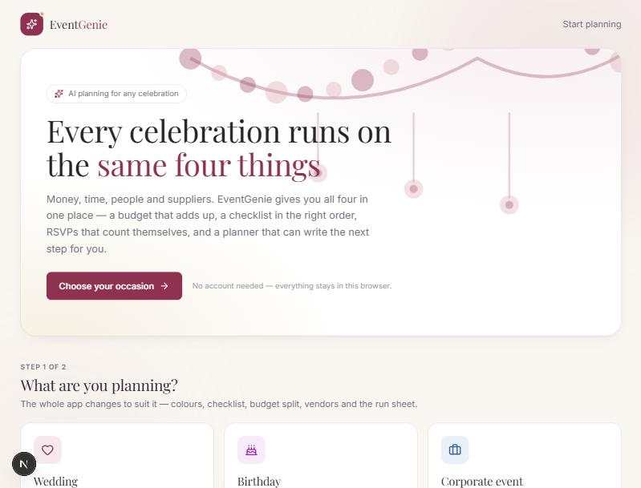
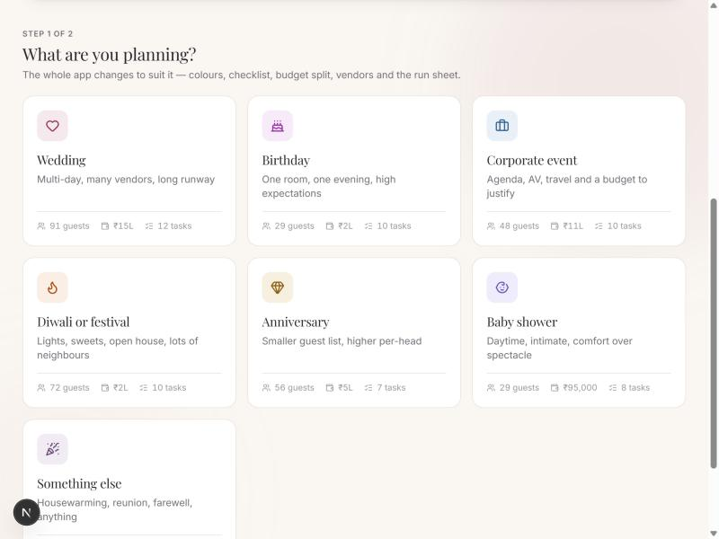
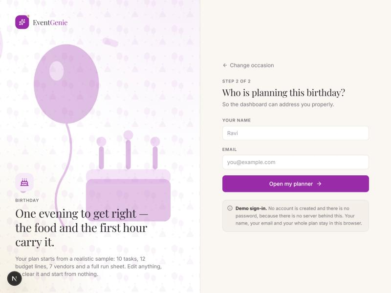
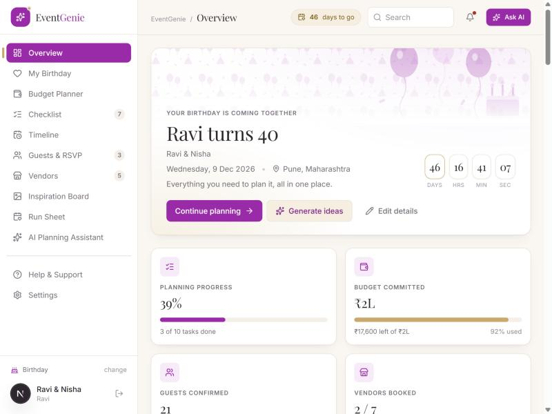
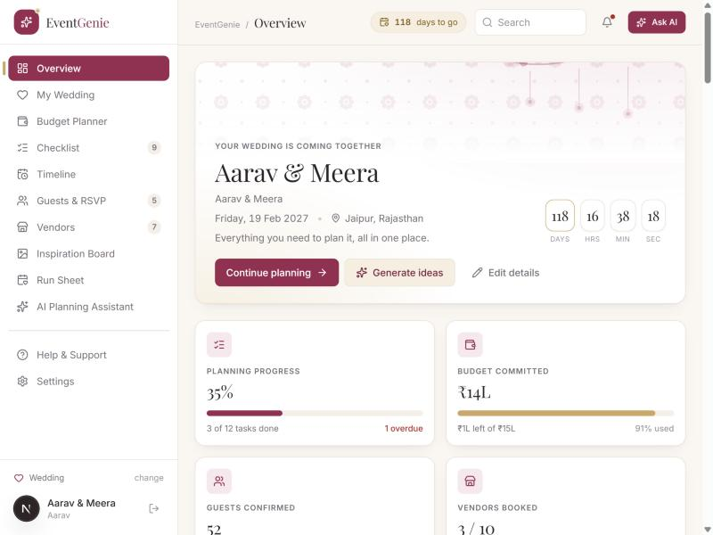
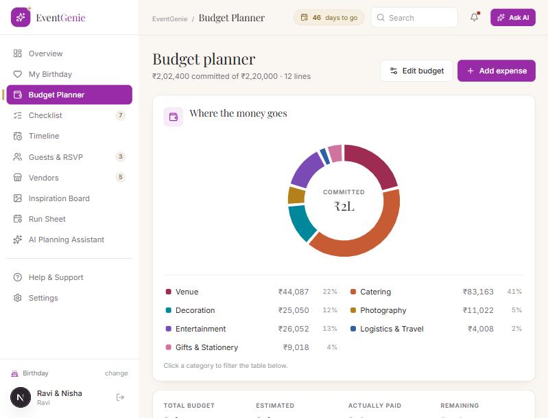
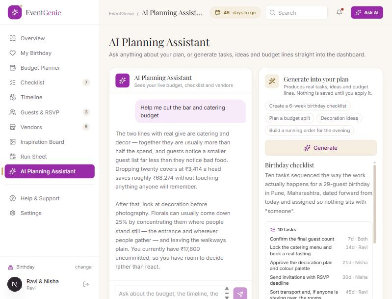

# EventGenie — AI planning for any celebration

Pick your occasion, sign in, and plan it: budget, checklist, timeline, guests, vendors,
inspiration, a run sheet, and an AI planner that writes real tasks, ideas and budget lines
straight into the dashboard.

**Seven occasions, each with its own theme and its own starter plan** — wedding, birthday,
corporate event, Diwali or festival, anniversary, baby shower, and a catch-all for everything
else. Choosing one re-skins the whole product: accent colour, decoration, copy, checklist,
budget split, vendors, run sheet and the assistant's suggested prompts.

Next.js 16 · React 19 · TypeScript · Tailwind v4 · Radix · Recharts · Zod · Anthropic SDK.

---

## Run it

```bash
npm install
npm run dev
```

Open <http://localhost:3000>.

**It works with no API key.** Without one, the assistant answers from a deterministic local
planner and every other screen is fully live. To use Claude:

```bash
cp .env.example .env.local   # then set ANTHROPIC_API_KEY
```

| Script | What it does |
| --- | --- |
| `npm run dev` | Dev server |
| `npm run build` / `npm start` | Production build and serve |
| `npm run typecheck` | `tsc --noEmit` |
| `npm run selftest` | 21 tests: redaction, fencing, derived arithmetic, validation, per-occasion plans, theme integrity, accent contrast |
| `EVENTGENIE_LIVE=1 npm run selftest` | Adds live probes of CSP, cross-origin refusal, error hygiene |
| `EVENTGENIE_LIVE=burst npm run selftest` | Adds the rate-limit burst (spends the hourly window) |

---

> **Making a demo video?** [`docs/demo-script.md`](docs/demo-script.md) has a 90-second shot
> list with narration, the generation prompts for the B-roll, and the checked figures so the
> voiceover and the screen agree.

## Screenshots

**Step 1 — pick the occasion.** The landing page is the product's front door: seven occasions,
each previewing its own accent and decoration before you commit to it.





**Step 2 — sign in.** Choosing Birthday re-skins everything: violet accent, balloons and a cake
instead of a marigold swag, and copy written for that occasion. No password — see the note in the
deviations section below.



**The dashboard, themed two ways.** Same code, same layout, same chart palette — only the
occasion differs.

| Birthday | Wedding |
| --- | --- |
|  |  |

Note the sidebar: *My Birthday* against *My Wedding*, and different task, RSVP and vendor counts,
because each occasion carries its own complete sample plan.

**Budget planner.** The donut is the one place the brand accent deliberately does *not* reach —
the eight category hues are a separate set, validated against the ivory canvas for contrast and
colourblind separation, and they stay put whatever occasion you pick.



**AI planning assistant.** Streaming chat on the left, structured generation on the right.
Everything it proposes is previewed and only written to your plan when you press *Apply*.



> Screenshots are from Guided Demo mode — no `ANTHROPIC_API_KEY` set, so the assistant is
> answering from the built-in deterministic planner. With a key it streams from Claude instead.

## The flow

```
/            pick your occasion   -> re-skins the app, loads that plan
/signin      say who you are      -> demo only: no password, no account, no server
/dashboard   ...and everything else
```

A route guard sends you back a step if you skip one. Plans are stored per occasion, so you can
plan a wedding, switch to a birthday, and come back to find both intact.

### Occasions

| Occasion | Accent | Decoration | Starter plan |
| --- | --- | --- | --- |
| Wedding | burgundy | marigold swag, hanging strands | Aarav & Meera, Jaipur, 15L, 91 guests |
| Birthday | violet | balloons, cake with candles, confetti | Ravi turns 40, Pune, 2.2L, 29 guests |
| Corporate event | slate blue | layered arcs and bars | Engineering offsite, Lonavala, 11L |
| Diwali or festival | deep saffron | hanging diyas with flames, rangoli arc | The Sharmas, Delhi NCR, 1.8L, 70 guests |
| Anniversary | antique gold | interlocking rings | Forty years, Kochi, 4.5L, 56 guests |
| Baby shower | lilac | drifting clouds and stars | A quiet Sunday, Bengaluru, 95K |
| Something else | plum | streamers and confetti | Housewarming, Hyderabad, 1.4L |

Each ships a full, internally consistent plan: expenses that sum exactly to the allocatable
budget, an RSVP split that adds up, a real vendor shortlist and an hour-by-hour run sheet.

## The ten screens

| Page | What it does |
| --- | --- |
| **Overview** | Hero with live countdown, four KPI cards, budget ring, task card, timeline, vendors, guests, inspiration, run sheet |
| **My Event** | The details everything is calculated from, plus a weighted progress breakdown |
| **Budget Planner** | Donut + category rollup + full ledger; add, edit and delete expenses; filter by category |
| **Checklist** | Filter by All / Pending / Completed / Overdue, search, full CRUD, priority and owner |
| **Timeline** | Milestones derived from the wedding date, flagged done / due now / overdue / ahead |
| **Guests & RSVP** | Household table with inline RSVP, meal and table; search, filter, CSV export |
| **Vendors** | Search and filter, shortlist, status workflow, side-by-side comparison of up to three |
| **Inspiration Board** | Category tabs, favourites, notes, add and edit |
| **Run Sheet** | Hour-by-hour schedule with owners; printable |
| **AI Planning Assistant** | Streaming chat plus structured generation you approve before it is applied |

Plus **Settings** (details, JSON export, reset) and **Help** (how it works, what it will not do).

Every number on every page is derived from one state object in
[`calculations.ts`](src/lib/calculations.ts). Add an expense on the budget page and the KPI card,
the ring, the category rollup and the legend all move together, because none of them keeps its
own copy of the total.

---

## The AI, and what it is allowed to do

```
browser → /api/assistant (streaming chat)
        → /api/generate  (JSON-Schema-constrained structured output)
```

[`ai-service.ts`](src/lib/ai-service.ts) is the only place the app talks to an AI, and it has two
implementations behind one interface:

- **With a key** — Claude Opus 5.5. Chat streams token by token. Generation is constrained by a
  JSON Schema (`output_config.format`), so the model cannot drift out of shape, then re-validated
  with Zod on the server *and* again in the browser before anything becomes the couple's data.
- **Without a key** — a deterministic planner classifies the prompt and returns grounded prose or
  a schema-valid `Generation`. The whole product is demonstrable offline and in CI.

**Nothing the model produces is written automatically.** Generation renders as a preview with the
tasks, ideas and budget lines it proposes; the couple presses *Apply to my plan*. Applied tasks
are tagged `source: "ai"` and badged in the UI, and duplicates are skipped on title.

The prompts are in [`prompts.ts`](src/lib/prompts.ts). They set a thinking order (money and
calendar outward), forbid inventing a vendor, venue, URL or quote, forbid inferring religion or
ritual from a name or city, and treat stated constraints as hard requirements.

---

## Security

| Concern | What is done |
| --- | --- |
| Key exposure | Server-only module guarded by `server-only`; no `NEXT_PUBLIC_*`; `connect-src 'self'` so the page cannot reach the provider |
| Prompt injection | Input fenced in `<untrusted>` tags with the fence characters stripped from the payload; replayed history re-fenced every turn; schema-constrained output bounds the blast radius |
| Untrusted model output | Validated server-side and client-side before it reaches state; rendered as React text, never HTML |
| PII | Emails, phones, cards, Aadhaar, IBAN and UPI redacted server-side before the model sees them. **Guest names are never sent at all** — the model context carries counts, not people |
| XSS | Per-request nonce CSP with `strict-dynamic`, `object-src 'none'`, `base-uri 'none'`, `frame-ancestors 'none'` |
| CSRF | Same-origin check on both routes |
| Abuse | Rate limiting: 20 generations and 60 messages an hour, with `Retry-After` |
| Error hygiene | Validation errors return field *paths*, never values; logs carry an error name and status only |

A test asserts the guest-name guarantee rather than trusting it:
`the wedding context sent to the model carries no guest names`.

---

## Data visualisation

Budget composition is a donut with the committed total in the hole, which becomes the hovered
slice's own figure. A ring compares nine magnitudes less well than bars do, so the ring answers
*what shape is this budget* and the category rollup beside it answers *which line is bigger* —
every value is written down either way, and a table view is never more than a glance away.

Colour is categorical: one fixed hue per spend category, assigned by position so a filter can
never repaint the survivors. The eight hues are a **palette built for this product and validated
as a set** against the ivory surface — lightness band, chroma floor, adjacent
colourblind separation (worst pair ΔE 13.7) and the normal-vision floor (worst pair ΔE 15.2) all
pass. "Miscellaneous" is the catch-all and takes the neutral.

This is why there are **exactly eight budget categories plus a catch-all**, shared across all
seven occasions: a ninth would need a ninth hue, and a generated one would void the validation.
A corporate offsite puts AV under Entertainment and branding under Decoration rather than
growing the list. Three tests enforce it — one fails if a series colour is declared more than
once, one if an occasion rule re-tints a series or the canvas, and one if any occasion accent
drops below 4.5:1 in a role it is used for.

---

## Imagery

Vendor and inspiration cards use [`Artwork.tsx`](src/components/ui/Artwork.tsx): deterministic
botanical SVG compositions drawn from the palette, five variants seeded per record. This is a
deliberate choice over stock photography — it avoids loosening `img-src`, leaking a referrer on
every card, and showing photographs of real venues next to invented vendor names. To use real
photos later: add an `imageUrl` to the record, render an `` when present, fall back to
`Artwork`, and add the host to `img-src`.

---

## Project layout

```
src/
  app/
    (public)/page.tsx         occasion picker
    (public)/signin/          demo sign-in
    (app)/dashboard/          Overview
    (app)/my-event|budget|checklist|timeline|guests|
          vendors|inspiration|schedule|assistant|settings|help/
    api/assistant/route.ts    streaming chat
    api/generate/route.ts     structured generation
    globals.css               design system + validated chart palette
  components/
    layout/                   AppShell, Sidebar, Topbar, nav
    ui/                       Radix + CVA primitives, Artwork, EventOrnaments
    dashboard/ budget/ checklist/ timeline/
    guests/ vendors/ inspiration/ schedule/ ai-assistant/
  data/
    template.ts               template type + share-to-amount builder
    events/                   one template per occasion
  hooks/useSession.tsx        chosen occasion + demo sign-in
  hooks/useEvent.tsx          one reducer, localStorage-backed per occasion
  hooks/useToast.tsx          notifications
  lib/
    calculations.ts           every derived figure
    ai-service.ts             real + deterministic AI behind one interface
    ai-schema.ts              the model contract (Zod + JSON Schema)
    prompts.ts  security.ts  ratelimit.ts  validation.ts  storage.ts
  lib/eventThemes.ts          accents, motifs, nouns, prompts per occasion
  types/event.ts
  proxy.ts                    per-request nonce CSP
scripts/selftest.mts
```

---

## Deliberate deviations from the brief

Three, each with a reason:

1. **shadcn/ui as a pattern, not the CLI.** The components in `components/ui` are Radix +
   `class-variance-authority` + `tailwind-merge` written against the token system already in
   `globals.css`. Running the generator would have introduced a second, competing theme config
   for no behavioural gain; the brief asks to adapt rather than build competing architectures.
2. **Generated artwork instead of stock photography**, for the privacy and honesty reasons above.
3. **Light theme only.** The brief specifies one palette. A second, unvalidated dark theme would
   have been worse than none, and the chart palette's guarantees are surface-specific.
4. **A sign-in step with no password.** There is no auth server behind this and no account is
   created, so a password field would be theatre that trains people to type a real one into a
   demo. Name and email are enough to personalise the dashboard, and the page says plainly that
   both stay in the browser.

## Known limits

- The rate limiter is in process memory: correct for one instance, resets on restart. Behind
  more than one node, move the same window arithmetic to Redis.
- Data lives in `localStorage`, so it is per-browser and does not sync. There is no account
  system, which is also why there is no personal data at rest on a server.
- The vendor directory is sample data — invented names, indicative prices, demo ratings. Marking
  one contacted or booked updates your own tracker and notifies nobody. The UI says so.
